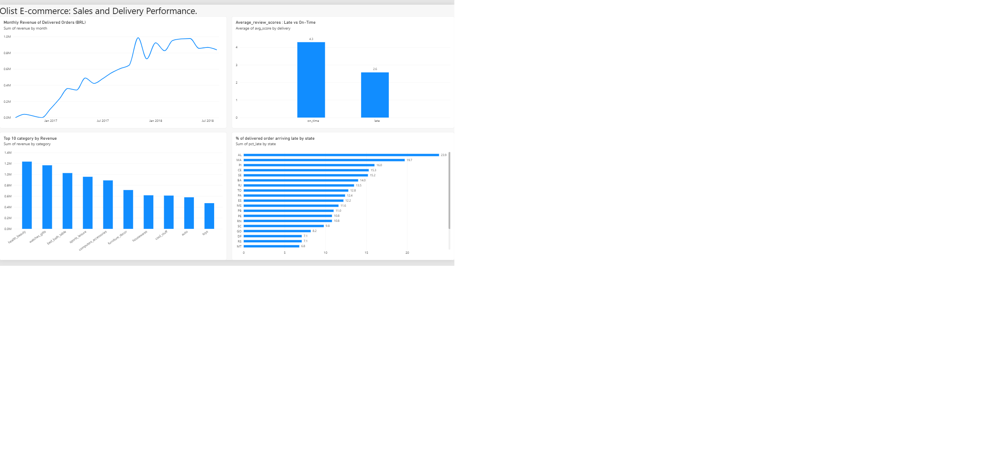

# Olist E-commerce Analysis: Sales and Delivery Performance 

Olist project we get it from kaggle ,that is brazilian online shop data
“The data runs from September 2016 to August 2018, about two years. There are no orders in November 2016, and 2016 overall has very few orders, so I treat 2016 as too small to show a trend.” 
# Business question
 What drives revenue and customer satisfaction on the Olist Brazilian online marketplace, and where do delivery problems hurt customers the most?
Data
 This project uses the Olist Brazilian e-commerce dataset from Kaggle. It contains about 99,000 orders placed between September 2016 and August 2018, spread across 8 tables. The tables are connected through ID columns such as order_id, which makes it possible to join orders with customers, payments, reviews, and sellers.
# Rules and decisions
I counted revenue only from delivered orders. Cancellations happen before delivery, and returns are not recorded in this dataset.
Revenue is the item price in Brazilian reais (BRL) and does not include shipping costs.
An order is late when it was delivered after its estimated delivery date.
Eight delivered orders had no delivery date, so I excluded them from delivery-time calculations.
I left out states with fewer than 100 orders from the late-orders chart, because small samples can give misleading percentages.

# Finding                                                                                                                                                     
- About 8.1% of delivered orders arrived after the estimated delivery date. Late orders average 2.57 stars, while on-time orders average 4.29 stars, a gap of about 1.7 points, so late delivery goes together with much lower ratings.
- 46.2% of late orders got a 1-star review, compared with 6.6% of on-time orders, so a late order was about 7 times as likely to get 1 star. Late orders are only about 8% of orders but about 38% of the 1-star reviews.
 - “Slow delivery is not always late delivery. AM is the third slowest state (26.4 days), but only 4.1% of its orders were late, probably because longer delivery dates are promised there. The states with the most late orders are AL (23.9%), MA, PI, CE and SE, and AL is bad on both measures. SP has only 5.9% late orders, and RJ misses the promised date on 13.5% of its 12,350 orders.” 

- “health_beauty earns the most revenue. bed_bath_table has the most orders and the most products, but watches_gifts earns about twice as much per order (about 212 vs 110 BRL), so it ranks higher in revenue.” (“watches_gifts earns more revenue than bed_bath_table even with fewer orders, because each order is worth more. watches_gifts earns about 212 BRL per order, whereas bed_bath_table earns about 110 BRL.” )

- “The top five states by revenue are SP, RJ, MG, RS and PR. SP has the most orders and makes up about 42% of orders but only about 38% of revenue, so its orders are worth less on average, about 125 BRL per order. RJ has fewer orders and lower total revenue than SP, but each order is worth more, about 142 BRL, so RJ’s orders are worth more than SP’s.” 

# Limitation                                                                                                                                                     
- This shows a link, not proof of cause. Late orders may differ from on-time orders in other ways, so late delivery may not be the only reason for the low scores
- This shows a link, not proof of cause. Late delivery may not be the only reason for these low ratings.“SP has the fastest delivery, at 8.8 days on average. Customers in RR wait more than 3 times as long (29.4 days), and the slowest states are RR, AP, AM, AL and PA. SP, MG and PR are among the biggest states by orders and also among the fastest. The slowest states have few orders (RR has only 41), so their averages are less reliable.”
- The data shows a link, not proof of cause.
- 2016 has very few orders, and November 2016 has none.
- The data ends in August 2018.
- Returns are not recorded.
- Some small-state results rest on few orders.
- I used customer location only, not seller location, so I could not test whether shipping distance explains slow deliveries.

# Recommendations
- Reduce late deliveries. Late orders were about 7 times as likely to get a 1-star review (46.2% vs 6.6%), so fixing late deliveries is the clearest way to improve customer ratings.
- Start with the states where the problem is biggest. AL has the highest share of late orders (23.9%), and RJ has a large number of late orders (1,664, or 13.5% of its orders).
- Look at the promised delivery dates. In states like AL, where deliveries are both slow and often late, the shop could set more realistic delivery estimates, or speed up shipping. This needs a closer look, because the data can’t tell us the cause.

